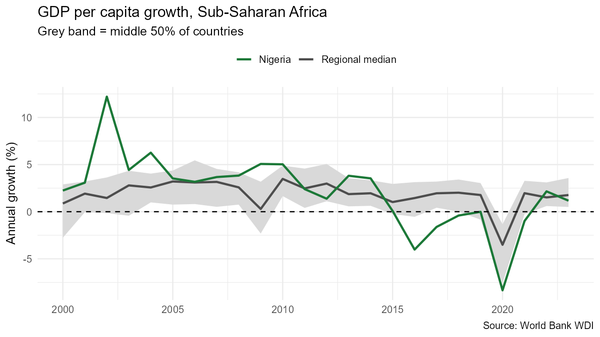
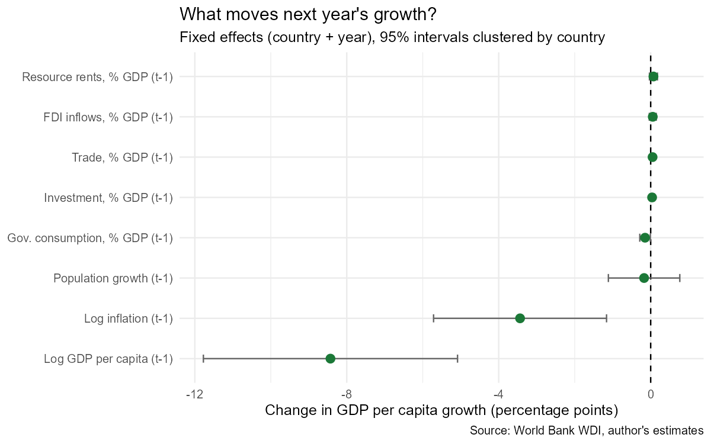

# What drives economic growth in Sub-Saharan Africa?

**A panel study of 42 countries, 2000-2023, using World Bank data, R and Stata.**

> **Finding:** Across 42 Sub-Saharan African economies (2000-2023), growth picks up after periods of greater trade openness and slows after high inflation and heavy government consumption.
>
> **In numbers (fixed effects, country and year):** +10 points of trade/GDP → about +0.5 points of per-capita growth the next year; inflation rising from 5% to 25% → about -0.6 points; +5 points of government consumption/GDP → about -0.7 points. Investment, FDI and resource rents show no reliable effect once country differences are controlled.

📊 **[Read the full report](https://philip01-sys.github.io/growth-drivers-panel/report/report.html)**





## What I did

- **Data:** downloaded 9 indicators for every Sub-Saharan African country from the World Bank API with a script, so the data can be refreshed in one click.
- **Cleaning:** removed regional aggregates, documented missing data, log-transformed skewed inflation, lagged all drivers one year to reduce reverse causality.
- **Models:** pooled OLS, fixed effects (country and year) and random effects, with a Hausman test to choose between them.
- **Checks:** standard errors clustered by country, plus Driscoll-Kraay errors for shocks common to all countries.
- **Two tools:** the same models in R (`plm`) and Stata (`xtreg`).

## Tools

R (dplyr, ggplot2, plm, sandwich) · Stata · Quarto · World Bank WDI API

## Project structure

```
code/
  00_setup.R       install packages
  01_download.R    pull data from the World Bank API
  02_clean.R       build the analysis panel
  03_explore.R     summary statistics and charts
  04_models.R      panel regressions and tests
  run_all.R        runs everything in order
  stata/models.do  the same models in Stata
data/raw, data/clean
output/figures, output/tables
report/report.qmd  full write-up (rendered to docs/ for GitHub Pages)
```

## Reproduce it

```r
# In RStudio, open growth-drivers-panel.Rproj, then:
source("code/run_all.R")
```
Then in the terminal: `quarto render`

## Need this for your data?

I'm a data and research analyst working in R, Stata, SPSS, EViews and Excel. I turn raw data into clear, defensible answers: econometrics, survey analysis, forecasting and dashboards.

**[LinkedIn](https://www.linkedin.com/in/philip-nuhu-data-analyst)** · **nuhuphilip61@gmail.com** · Available for remote roles and freelance projects worldwide.
